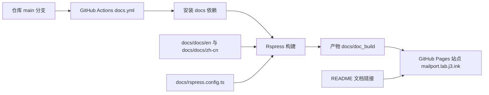

# MailPort 文档站与自动部署

Feature Name: mailport-docs-site
Updated: 2026-10-25

## Description

MailPort 的用户文档目前以 `doc/en` 与 `doc/zh-cn` 两组 Markdown 存放，只能通过仓库页面阅读。本特性为 MailPort 增加一个与 Rin 文档站同构的 Rspress 双语文档站，并把站点发布纳入 GitHub Actions 的自动流程：推送到 `main` 分支且 `docs/` 发生变化时自动构建并发布到 GitHub Pages。

范围包含三部分：文档源迁移到独立文档工程、Rspress 站点配置与导航、Pages 发布工作流。MailPort 应用本身（Next.js 控制台与发件 API）保持不变。

## Architecture



- `docs/` 为独立文档工程，拥有自己的 `package.json` 与依赖锁文件，不参与 MailPort 应用构建。
- Rspress 读取 `docs/rspress.config.ts` 中的 `root` 指向 `docs/docs`，按 locale 目录生成两套路由。
- `docs/doc_build/` 为构建产物目录，被 `docs/.gitignore` 忽略。
- `.github/workflows/docs.yml` 使用 `actions/configure-pages`、`actions/upload-pages-artifact`、`actions/deploy-pages` 完成发布。

## Components and Interfaces

### docs/package.json

```json
{
  "name": "mailport-docs",
  "private": true,
  "scripts": {
    "dev": "rspress dev",
    "build": "rspress build",
    "preview": "rspress preview"
  },
  "dependencies": {
    "@rspress/core": "^2.0.1"
  }
}
```

依赖使用 npm 安装，锁文件 `docs/package-lock.json` 提交入库，保证 Actions 构建可复现。

### docs/rspress.config.ts

| 配置项 | 取值 | 作用 |
|--------|------|------|
| `root` | `path.join(__dirname, 'docs')` | 文档源根目录 |
| `lang` | `zh-cn` | 默认语言（默认语言占据站点根路径） |
| `locales` | `zh-cn` / `en` | 双语站点，简体中文标签为「简体中文」 |
| `base` | `/` | 自定义域名 `mailport.lab.j3.ink` 部署在根路径 |
| `title` / `description` | MailPort | 站点标题与描述 |
| `themeConfig.socialLinks` | GitHub 仓库地址 | 页头仓库入口 |
| `i18nSource` | `zh-cn` / `en` | 主题文案本地化（大纲、搜索、导航等） |

站点通过自定义域名 `https://mailport.lab.j3.ink` 在根路径对外提供，`base` 取 `/`；若改回 GitHub Pages 默认地址 `wool-hmq.github.io/mailport/`，需把 `base` 同步改回 `/mailport/`，否则静态资源与路由会 404。

### 文档源目录

```text
docs/
├── docs/
│   ├── index.md            # 站点首页（简体中文）
│   ├── public/             # 静态资源（图标）
│   ├── en/
│   │   ├── _nav.json       # 顶部导航栏
│   │   ├── _meta.json      # 全局侧边栏
│   │   ├── index.md        # English 首页
│   │   └── api.md / database.md / deploy.md / env.md / http-sender.md / oauth.md
│   └── zh-cn/
│       ├── _nav.json
│       ├── _meta.json
│       └── （与 en 同名的六篇文档）
├── package.json
├── package-lock.json
└── rspress.config.ts
```

Rspress v2 的导航约定：

- `_nav.json` 位于语言目录根部，声明顶部导航栏，条目使用 `text` 与 `link`。
- `_meta.json` 位于语言目录根部时声明全局侧边栏，条目使用 v2 对象格式 `{"type": "file", "name": "api.md", "label": "API 参考"}`。
- 语言目录根部使用带 `text` 键的旧版 `_meta.json` 会触发 Rspress v2 的迁移校验错误并终止构建。

### .github/workflows/docs.yml

- 触发条件：`main` 分支上 `docs/**` 或工作流文件变更，以及 `workflow_dispatch` 手动触发。
- 权限：`contents: read`、`pages: write`、`id-token: write`。
- 并发：`group: pages`、`cancel-in-progress: false`，保证多次发布串行执行。
- 构建步骤：检出仓库 → 安装 Node.js → `npm ci`（工作目录 `docs`）→ `npm run build` → 上传 `docs/doc_build`。
- 发布步骤：`actions/deploy-pages`，环境为 `github-pages`。

### README.md

README 的文档入口改为在线站点地址（`https://mailport.lab.j3.ink/`），文档表格中的相对链接改为迁移后的 `docs/docs/...` 路径，保证仓库内阅读与在线阅读一致。

## Data Models

### 导航配置

顶部导航 `_nav.json`：

```json
[
  {
    "text": "文档",
    "items": [{ "text": "API 参考", "link": "/api" }]
  }
]
```

全局侧边栏 `_meta.json`：

```json
[
  { "type": "file", "name": "api.md", "label": "API 参考" }
]
```

### Locale 映射

| 配置 lang | 目录 | 站点路径 |
|-----------|------|----------|
| `zh-cn` | `docs/docs/zh-cn/` | `/`（默认语言占据根路径） |
| `en` | `docs/docs/en/` | `/en/` |

Rspress 以 locale 的 `lang` 值匹配同名目录，默认语言目录的内容输出到站点根路径，其余语言保留语言前缀。该行为与 Rin 文档站一致（Rin 的简体中文同样位于根路径）。

## Correctness Properties

1. 构建产物中静态资源引用以 `/` 为根，与自定义域名的根路径部署一致。
2. `docs/docs/en/` 与 `docs/docs/zh-cn/` 中同名文档保持语义对应，页面结构一致。
3. `docs/doc_build/` 中同时存在根路径 `index.html` 与 `en/` 目录，根路径页面为简体中文、`en/` 页面为 English。
4. 工作流上传的产物目录与 Rspress 输出目录一致，部署后不会出现资源缺失。
5. 仓库内 `package.json`（应用）与 `docs/package.json`（文档）互不影响，应用构建流程不包含文档依赖。
6. 两种语言的顶部导航与侧边栏均包含六篇文档入口，语言切换后入口文案同步切换。

## Error Handling

| 场景 | 处理方式 |
|------|----------|
| 依赖安装失败 | Actions 构建步骤失败，工作流整体失败并保留日志 |
| Markdown 内部链接失效 | Rspress 构建阶段报错，阻止发布 |
| 仓库未启用 Pages | `actions/configure-pages` 失败，需在仓库 Settings → Pages 将 Source 设为 GitHub Actions |
| `base` 与部署路径不一致 | 站点可构建但资源 404，自定义域名用 `/`，仓库子路径用 `/mailport/` |

## Test Strategy

1. 本地执行 `npm run build`，确认构建成功且产物包含 `index.html` 与 `en/`。
2. 检查产物首页与语言入口链接可访问，资源路径以 `/` 为根。
3. 检查两种语言页面的顶部导航与侧边栏均包含六篇文档入口。
4. 执行 `npm run dev` 启动本地开发服务器，通过平台预览地址验证页面渲染与语言切换。
5. 推送后检查 GitHub Actions 运行记录，确认构建与部署两个 job 均成功。

## References

[^1]: (Rspress) - 国际化与多语言目录结构（https://rspress.dev/guide/basic/i18n）
[^2]: (Rspress) - 配置项：root、lang、locales、base（https://rspress.dev/api/config/config-basic）
[^3]: (Rin 仓库) - 文档站配置与 Pages 工作流参考实现（docs/rspress.config.ts、.github/workflows/docs.yml）
[^4]: (GitHub) - Pages 部署工作流配置（https://docs.github.com/en/pages/getting-started-with-github-pages/using-custom-workflows-with-github-pages）
